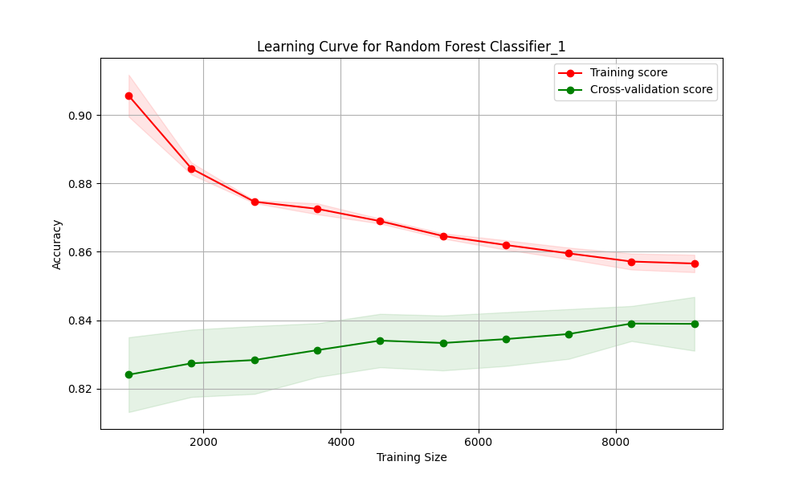
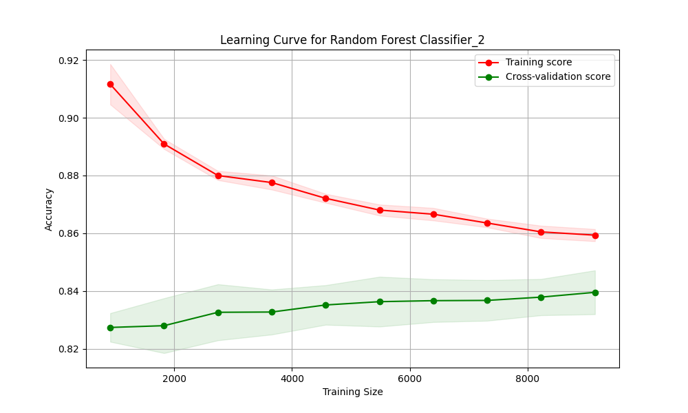
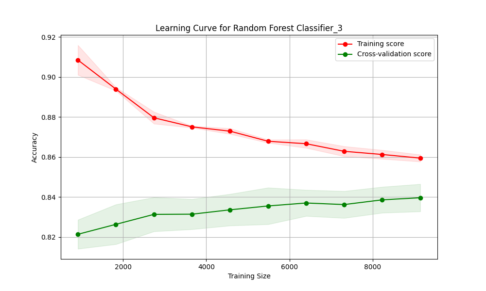
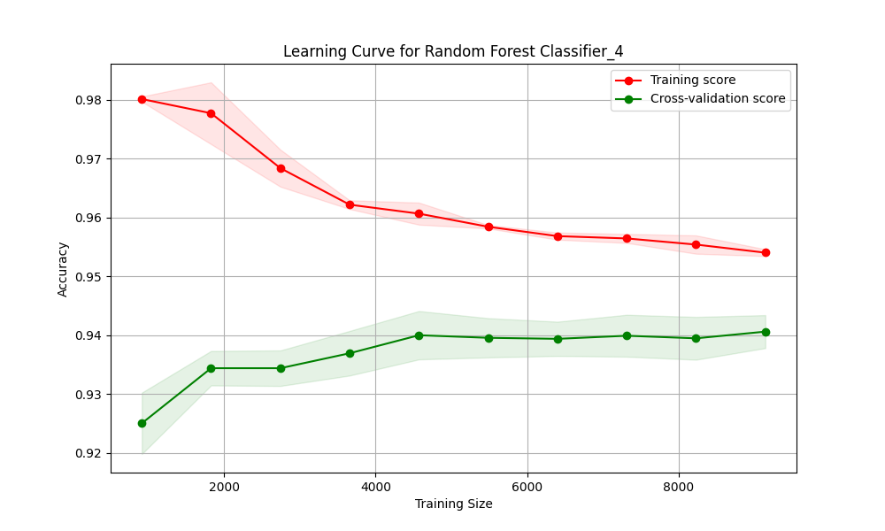
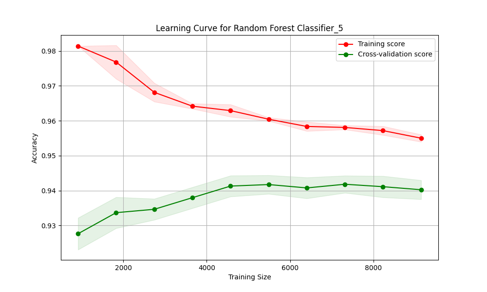

컴퓨터 네트워크 수업 프로젝트로, 피싱 URL 탐지 크롬 확장 프로그램의 **ML 모델**을 설계하고 최적화했습니다. 
해외 학생들과 함께 5인 팀으로 협업했습니다.

 

## 주요 작업

- 피싱 URL 탐지를 위해 CNN, DNN, 랜덤 포레스트 모델을 구현하고 비교했습니다.
- 원본 URL로 CNN을 학습해 **정확도 92%**를 달성했습니다.
- 특성 기반 DNN으로 바꿔 정확도를 **95%**까지 높였습니다.
- **특성 중요도 기반 선택**을 적용하고 랜덤 포레스트 모델을 평가해, 더 빠른 추론 속도로 **정확도 94%**를 달성했습니다.

  
  
  
  
  

  <a href="/assets/report/testing_of_model.pdf" download class="text-sm text-slate-500 font-medium hover:text-emerald-600 transition-colors inline-flex items-center gap-1 group">
    특성 선택 과정 보고서
    <svg xmlns="http://www.w3.org/2000/svg" fill="none" viewBox="0 0 24 24" stroke-width="1.5" stroke="currentColor" class="w-4 h-4 group-hover:animate-bounce">
      <path stroke-linecap="round" stroke-linejoin="round" d="M3 16.5v2.25A2.25 2.25 0 0 0 5.25 21h13.5A2.25 2.25 0 0 0 21 18.75V16.5M16.5 12 12 16.5m0 0L7.5 12m4.5 4.5V3" />
    </svg>
  </a>

- 학습한 모델을 백엔드 API를 통해 크롬 확장 프로그램과 연결했습니다.

 

## 배운 점

- 모델 복잡도보다 데이터셋 크기, 데이터 품질, 특성 선택이 성능에 더 큰 영향을 주었습니다.
- 데이터가 제한된 상황에서는 정확도와 추론 속도 사이의 균형을 고려해 모델을 골라야 했습니다.
- 팀 실험이 잘 굴러가려면 역할 분담이 명확하고 결과를 정기적으로 공유해야 했습니다.
